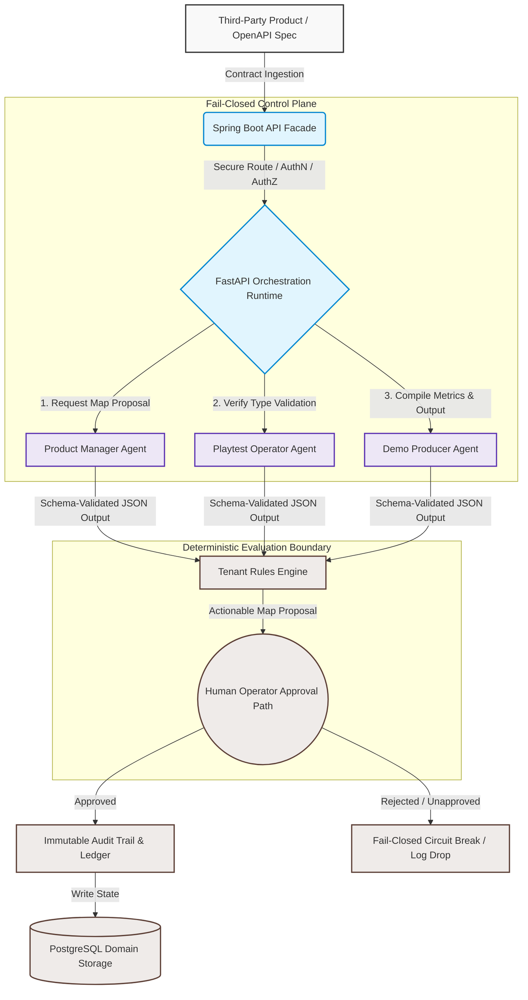

# Pardeep Kadian | Principal AI Systems Architect
📍 Bangalore, India | ✉️ kadian.pardeep@gmail.com | 💼 [LinkedIn](https://linkedin.com) | 🌐 [Live Platform: Sahatrix](https://sahatrix.com)

A hands-on Systems Architect with 25+ years of experience bridging hard-core systems fundamentals (low-latency C++, real-time graphics, enterprise content repositories) with production-grade AI infrastructure. Specializing in secure, governed multi-agent orchestration, RAG architectures, and Model Context Protocol (MCP) implementations.

---

## 🛠️ Active Production Case Study: Sahatrix
**Product Details:** [://sahatrix.com](https://sahatrix.com)  

Sahatrix is a private, multi-domain integration control plane that automates cross-platform onboarding directly from OpenAPI contracts, eliminating hardcoded vendor adapters.

### 📐 System & Optimization Metrics
* **65% Reduction in Token Costs:** Achieved by discarding text-heavy context loops in favor of named, role-specific AI agents enforcing rigid, contract-driven schema validation.
* **Deterministic Governance:** Enforced a strict "models propose, humans approve" workflow backed by a fail-closed tenant isolation model and immutable audit trails. Unapproved maps never execute.
* **Production-Grade Portability:** Engineered a decoupled runtime featuring a FastAPI orchestration plane, Spring Boot facade, and React operator UI—packaged uniformly on Docker Compose for seamless cloud and on-prem profiles.

### 🧬 Technology Stack Matrix
* **Orchestration / Core:** Python, FastAPI, Java Spring Boot, Node.js, LangGraph
* **Integration / AI Infra:** Model Context Protocol (MCP), OpenAPI, Azure OpenAI, RAG, OpenTelemetry
* **Data / Security:** PostgreSQL, MongoDB, Multi-tenant AuthN/AuthZ, Fail-Closed Security Boundaries
* **DevOps / Compute:** Docker, Kubernetes, Helm, AWS, Azure, CI/CD, SAST Scanning

---

## 🏗️ Core Engineering Philosophy
* **Code as a Liability:** Systems should be decoupled and contract-driven. The best adapter project is the one you never had to write.
* **Predictable AI:** LLMs belong behind deterministic guardrails. Schema-validated model outputs and strict type safety are mandatory for enterprise workloads.
* **Latency Matters:** Having optimized real-time Forex trading platforms from 5s down to 300ms, I evaluate AI data pipelines through a lens of raw performance and mechanical sympathy.

### 📐 Architectural Topology

## 🤝 Let's Connect
The Sahatrix repository is hosted in a private enterprise account. I routinely host private, live architecture walkthroughs and system code reviews for engineering leaders, CTOs, and peer architects. 

If you are scaling agentic infrastructure, optimizing LLM token spend, or want to look at the Sahatrix control plane under the hood, feel free to reach out via **kadian.pardeep@gmail.com**.
